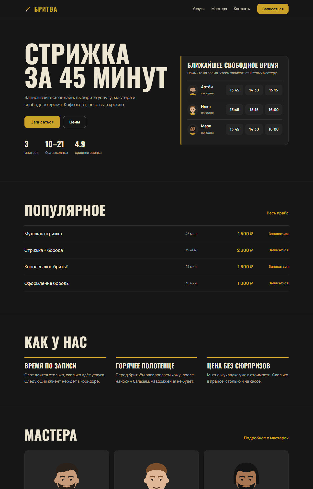

# Бритва — сайт-визитка барбершопа

Учебный проект для портфолио на FL.ru. Барбершоп «Бритва» вымышленный, заказчика нет. Сайт сделал Егор Фарафонов, [профиль на FL.ru](https://www.fl.ru/users/farafonovegor07/).

Живая версия: https://xevorin.github.io/britva-barber/



## Что есть на сайте

- Четыре страницы: главная, услуги, мастера, контакты. Общая шапка подсвечивает текущий раздел, на телефоне меню открывается бургером.
- На главной табло «Ближайшее свободное время»: по каждому мастеру три ближайших свободных слота. Нажатие на время открывает запись к этому мастеру на этот слот.
- Прайс в трёх группах (стрижки, борода, комплексы), у каждой услуги длительность и цена. Кнопка «Записаться» в строке открывает запись с уже выбранной услугой.
- Три мастера со стажем и специализацией. Портреты нарисованы в SVG, стоковых фото нет.
- Запись в четыре шага: услуга, мастер, дата и время, имя и телефон. Даты на 7 дней вперёд, слоты с 10:00 до 19:45 каждые 45 минут. Часть слотов занята: занятость считается хэшем от даты, мастера и времени, поэтому одинакова при каждом открытии. Прошедшее время сегодня недоступно.
- Проверка формы: имя только буквами от 2 символов, телефон в формате +7 (XXX) XXX-XX-XX, маска подставляется при вводе. Ошибки показаны под полями.
- После записи окно «Вы записаны» с итогом: услуга, мастер, дата, время, цена, контакты.
- Запись демонстрационная: данные никуда не отправляются, об этом написано в окне.
- На экранах уже 768 px внизу закреплена кнопка «Записаться».
- Контакты: адрес, телефон, часы работы, Яндекс Карта (виджет без ключа API).

## Доступность и адаптив

- Вёрстка работает от 360 px без горизонтальной прокрутки.
- Видимый фокус у всех интерактивных элементов, ссылка «К содержимому».
- Модальное окно держит фокус внутри, закрывается по Esc и возвращает фокус на кнопку, которой его открыли.
- Заголовки идут по порядку, без пропусков уровней.
- При включённой настройке «уменьшить движение» анимации отключаются.
- У страниц есть meta description, Open Graph и favicon.

## Стек

HTML, CSS и JavaScript без фреймворков и сборки. Шрифты Oswald и Manrope из Google Fonts. Цены набраны в Manrope: в Oswald нет знака ₽.

```
britva-barber/
├── index.html
├── services.html
├── masters.html
├── contacts.html
├── css/style.css
├── js/app.js      данные услуг и мастеров, меню, табло, запись
├── favicon.svg
└── screenshot.png
```

## Как открыть

Скачайте репозиторий и откройте `index.html` в браузере. Сервер не нужен, все пути относительные. Карта на странице контактов грузится из интернета.
